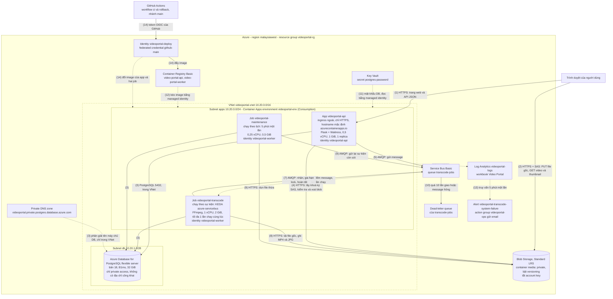

# Kiến trúc trên Azure (bản đang chạy, cập nhật 2026-11-21)

**Trạng thái: ĐÃ TRIỂN KHAI VÀ ĐANG CHẠY** ở region `malaysiawest`, resource group `videoportal-rg`, trên subscription Azure for Students của chủ dự án. Terraform trong `infra/azure/` quản lý 48 tài nguyên (theo `docs/PROGRESS.md`). Địa chỉ công khai: `https://videoportal-api.bravecoast-ef9b0b40.malaysiawest.azurecontainerapps.io` (hostname mặc định của Azure).

Tài liệu này mô tả **những gì đã được tạo thật**, lấy từ các file `infra/azure/*.tf` và từ bằng chứng trong `docs/EVIDENCE.md` (các mục "Azure deployment — …") và `docs/PROGRESS.md` (các mục ngày 2026-11-21, Azure Phase 08–12). Chỗ nào chưa kiểm chứng trên Azure thì ghi rõ là chưa. Quyết định: ADR-024 đến ADR-029 trong `docs/DECISIONS.md`.

Lý do chọn Azure: chủ dự án quyết định bỏ AWS và chỉ làm Azure (2026-11-21). Đề bài (`references/…pdf`, trang 1–2) cho chọn một trong AWS / Azure / GCP. Dòng Azure trong bảng gợi ý của đề: *App Service API; Azure Database for PostgreSQL; Blob Storage; Service Bus; Functions or Container Apps workers. Use bounded Container Apps Jobs for conversion.* Về danh tính: *Use … Entra External ID on Azure … or justify another OIDC provider. … put secrets in … Key Vault.*

Phần AWS (ADR-021/022/023, `docs/AWS_ARCHITECTURE.md`, `infra/aws/`) là tài liệu lưu trữ; mã adapter AWS và `deploy/aws/` đã được gỡ khỏi `main` ở Phase 07; nhánh `aws` trên GitHub giữ nguyên bản AWS cuối cùng. Trên AWS chỉ từng tạo một chứng chỉ ACM (miễn phí), chưa xoá. Bản VPS vẫn chạy nguyên trạng và không bị sửa trong lúc chuyển.

## Sơ đồ kiến trúc thực tế

Số trong ngoặc trên mũi tên là số thứ tự trong mục "Luồng mạng" bên dưới. Đường nét liền là dữ liệu của ứng dụng; đường nét đứt là việc của nền tảng (đếm message, kéo image, cấp secret, ghi log, triển khai). Khung nét đứt là VNet: thứ duy nhất nằm trong đó mà không có địa chỉ công khai là database.

Giải thích ngắn:

- Người dùng chỉ nói chuyện với hai nơi: app `videoportal-api` (trang web và API) và Blob Storage (file video, bằng URL có chữ ký sống 120 giây do API cấp). File video **không** đi qua API.
- API ghi job và sự kiện vào PostgreSQL trong cùng một giao dịch (outbox), rồi gửi message sang queue `transcode-jobs`. KEDA thấy message thì tạo một lần chạy của job `videoportal-transcode`; lần chạy đó xử lý đúng một video bằng FFmpeg rồi thoát.
- Job `videoportal-maintenance` chạy 5 phút một lần: thu hồi lease hết hạn, gửi lại sự kiện còn sót, dọn file thừa. Không có tiến trình worker nào chạy liên tục.
- Database là thành phần duy nhất chỉ có đường riêng. Storage, Service Bus, Key Vault và Container Registry có endpoint công khai nhưng không nhận khoá dùng chung: chỉ nhận token Entra ID của managed identity (và, với Blob Storage, SAS do identity `api` ký).
- GitHub Actions build image và triển khai qua identity `videoportal-deploy`, không có mật khẩu hay khoá nào lưu ở GitHub.

Ngoài các tài nguyên trong Terraform, Azure tự tạo một load balancer Standard và một địa chỉ IP công khai Standard cho environment (resource group `ME_videoportal-env_…`), vì environment nằm trong VNet riêng. Đó là đường vào của mũi tên (1). Hai thứ này thấy được sau `apply`, không khai báo trong `infra/azure/`.

### Tài nguyên đã tạo

Tên có `<hậu tố>` kèm 6 ký tự ngẫu nhiên do Terraform sinh (`random_string.suffix`), vì các tên đó phải duy nhất toàn Azure. Cấu hình ghi theo giá trị trong các file `.tf` và giá trị mặc định của `variables.tf`; file `terraform.tfvars` (đã gitignore, không ghi ở đây) ghi đè `auth_provider = "local"` và `api_min_replicas = 1`.

| Dịch vụ | Tên tài nguyên | Cấu hình thật | File |
| --- | --- | --- | --- |
| Virtual Network | `videoportal-vnet` | `10.20.0.0/16`; subnet `apps` `10.20.0.0/24` uỷ quyền cho `Microsoft.App/environments`; subnet `db` `10.20.1.0/28` uỷ quyền cho `Microsoft.DBforPostgreSQL/flexibleServers` (có service endpoint `Microsoft.Storage` do PostgreSQL tự thêm) | `network.tf` |
| Private DNS zone | `videoportal.private.postgres.database.azure.com` | liên kết với VNet (`videoportal-db-link`) | `network.tf` |
| Container Apps environment | `videoportal-env` | trong subnet `apps`; chỉ có profile Consumption; log về `videoportal-logs` | `apps.tf` |
| Container App | `videoportal-api` | image `video-portal-api`; ingress ngoài, cổng 8000, không cho HTTP thường; 0,5 vCPU, 1 GiB; tối thiểu 1, tối đa 1 replica; chế độ một revision; readiness probe `/health` | `apps.tf` |
| Container Apps Job (event) | `videoportal-transcode` | image `video-portal-worker`; luật scale `azure-servicebus` (`messageCount = 1`, thăm dò 30 giây, 0–1 lần chạy); 1 vCPU, 2 GiB; replica timeout 600 giây; nền tảng không tự thử lại (`replica_retry_limit = 0`) | `apps.tf` |
| Container Apps Job (schedule) | `videoportal-maintenance` | image `video-portal-api`, lệnh `flask --app app.main maintain`; cron `*/5 * * * *` (UTC); 0,25 vCPU, 0,5 GiB; replica timeout 300 giây | `apps.tf` |
| Azure Database for PostgreSQL flexible server | `videoportal-pg-<hậu tố>` | bản 18, `B_Standard_B1ms`, 32 GiB, sao lưu 7 ngày, `public_network_access_enabled = false`; database `video_portal` | `data.tf` |
| Storage account | `videoportal<hậu tố>` | StorageV2, Standard LRS, TLS tối thiểu 1.2, tắt truy cập công khai và tắt account key, bật versioning, CORS cho origin của trang; container `media` (private); luật tự xoá phiên bản blob cũ sau 7 ngày | `data.tf` |
| Service Bus | `videoportal-sb-<hậu tố>` | bậc Basic, tắt xác thực bằng khoá (`local_auth_enabled = false`); queue `transcode-jobs`: lock 5 phút, `max_delivery_count = 10`, dead-letter queue có sẵn | `data.tf` |
| Key Vault | `videoportal-kv-<hậu tố>` | bậc standard, phân quyền bằng RBAC, soft delete 7 ngày; một secret `postgres-password` | `data.tf` |
| Container Registry | `videoportal<hậu tố>` | bậc Basic, tắt tài khoản admin | `apps.tf` |
| Log Analytics workspace | `videoportal-logs` | PerGB2018, giữ log 30 ngày | `apps.tf` |
| Azure Monitor workbook | "Video Portal" | 7 ô truy vấn trên log JSON của `api` và hai job | `monitoring.tf` |
| Alert (scheduled query rule) | `videoportal-transcode-system-failure` | mức 2; cửa sổ 5 phút, đánh giá 5 phút một lần; gửi email qua action group `videoportal-ops` | `monitoring.tf` |
| User-assigned managed identity | `videoportal-api`, `videoportal-worker`, `videoportal-deploy` | xem mục "Ranh giới bảo mật"; `deploy` có federated credential `github-main` | `identity.tf`, `github.tf` |

Không có trong hệ thống: Microsoft Entra External ID (chưa tạo external tenant), App Service, Redis, Kubernetes, private endpoint, WAF/Front Door, tên miền riêng gắn vào app.

## Luồng mạng

1. **Trình duyệt → `videoportal-api`: HTTPS công khai (443)** tới hostname mặc định `*.azurecontainerapps.io`. TLS kết thúc ở ingress của environment; ingress chuyển tiếp vào container ở cổng 8000. HTTP thường bị chuyển hướng 301 sang HTTPS (đã thấy). Trang web, đăng nhập và mọi lời gọi API JSON đi đường này.
2. **Trình duyệt → Blob Storage: HTTPS công khai kèm SAS.** Upload là một lệnh `PUT` thẳng lên blob bằng user delegation SAS chỉ có quyền tạo đúng một blob; phát video và thumbnail là `GET` bằng SAS chỉ đọc trỏ vào đúng một phiên bản của blob (`versionid`). SAS sống 120 giây. Dịch vụ Blob chỉ nhận request của trình duyệt từ origin của trang (luật CORS: `GET`, `HEAD`, `PUT`).
3. **`api`, `transcode`, `maintenance` → PostgreSQL: giao thức PostgreSQL, cổng 5432, đường riêng trong VNet** (subnet `apps` → subnet `db`). Tên máy chủ chỉ phân giải được trong VNet nhờ private DNS zone. Máy chủ yêu cầu TLS; ứng dụng không kiểm tra chứng chỉ của máy chủ (`sslmode` mặc định của libpq).
4. **`api` → Blob Storage: HTTPS, token của identity `videoportal-api`.** Lấy user delegation key để ký SAS (khoá sống 1 giờ, lấy lại khi gần hết hạn), đọc kích thước và kiểu của blob ở bước `complete`, xoá blob và các phiên bản khi xoá video.
5. **`api` → Service Bus: AMQP qua TLS, token của identity `videoportal-api`.** Gửi message vào `transcode-jobs` ngay sau khi giao dịch `complete` đã commit. Gửi lỗi thì chỉ ghi log; bước 9 gửi lại sau.
6. **KEDA (do nền tảng Container Apps chạy) → Service Bus:** 30 giây một lần hỏi số message của queue bằng identity `videoportal-worker`; có message thì tạo một lần chạy của `videoportal-transcode` (tối đa 1 lần chạy cùng lúc).
7. **`transcode` → Service Bus: AMQP qua TLS, identity `videoportal-worker`.** Nhận một message (peek-lock), gia hạn lock trong lúc FFmpeg chạy, hoàn tất message khi xong; message hỏng thì chủ động đưa sang dead-letter queue.
8. **`transcode` → Blob Storage: HTTPS, identity `videoportal-worker`.** Tải file gốc theo đúng phiên bản, ghi `video.mp4` và `thumbnail.jpg` vào `outputs/<job>/<attempt>/`.
9. **`maintenance` → PostgreSQL, Service Bus, Blob Storage** (cùng các đường 3, 5, 8, identity `videoportal-worker`): thu hồi lease hết hạn, gửi lại sự kiện outbox còn sót, dọn upload bỏ dở và output thừa.
10. **Service Bus → dead-letter queue** (bên trong dịch vụ): message được giao quá 10 lần hoặc hết hạn thì tự chuyển sang dead-letter queue của `transcode-jobs`.
11. **Nền tảng Container Apps → Key Vault: HTTPS, managed identity.** Nền tảng đọc secret `postgres-password` bằng identity của app/job rồi đưa vào container dưới dạng biến môi trường `POSTGRES_PASSWORD`. Mã ứng dụng không gọi Key Vault.
12. **Nền tảng Container Apps → Container Registry: HTTPS, managed identity (role `AcrPull`).** Mỗi lần chạy job kéo image (đo được 8–10 giây cho 257 MB).
13. **Container → Log Analytics:** stdout/stderr của `api` và hai job (log JSON) được nền tảng gửi về `videoportal-logs`, chậm khoảng 1–3 phút. Luật alert truy vấn workspace 5 phút một lần; khi nổ thì action group `videoportal-ops` gửi email.
14. **GitHub Actions → Azure: HTTPS, OIDC federation.** Workflow trên nhánh `main` đổi token OIDC của GitHub lấy token của identity `videoportal-deploy`, đẩy hai image lên registry, rồi đổi image của app và hai job qua Azure Resource Manager (`deploy/azure/deploy.sh`).
15. **Người vận hành → Azure:** Terraform và Azure CLI chạy từ máy của chủ dự án bằng phiên `az login` của họ (state cục bộ, đã gitignore). Không ai nối được vào database từ ngoài VNet; `init-db` đã chạy bằng một lần chạy của job `maintenance` với lệnh ghi đè.

Các đường 4, 5, 7, 8, 11, 12 đi từ subnet `apps` tới **endpoint công khai** của từng dịch vụ (không có private endpoint); thứ bảo vệ chúng là TLS và token Entra ID, không phải ranh giới mạng.

## Ranh giới bảo mật

### Cái gì công khai, cái gì riêng tư

| Thành phần | Truy cập từ Internet | Thứ bảo vệ |
| --- | --- | --- |
| `videoportal-api` | **Công khai**, chỉ HTTPS. Đây là đường vào duy nhất của ứng dụng | Đăng nhập (token phiên), kiểm tra quyền Owner/Viewer ở từng route; không token → 401, không có quyền → 404 (đã kiểm tra trên Azure, Test 3b) |
| Blob Storage, container `media` | Endpoint công khai, nhưng **không có blob nào công khai** | Tắt truy cập ẩn danh và tắt account key; chỉ nhận token Entra ID hoặc user delegation SAS. Đã thấy: URL không có SAS → 409, SAS bị sửa chữ ký → 403 |
| Service Bus | Endpoint công khai | Tắt khoá SAS của namespace; chỉ nhận token Entra ID có role trên đúng queue |
| Key Vault | Endpoint công khai | RBAC; hai identity của workload chỉ đọc được đúng một secret |
| Container Registry | Endpoint công khai | Tắt tài khoản admin; kéo cần `AcrPull`, đẩy cần `AcrPush` |
| PostgreSQL | **Riêng tư**: không có địa chỉ công khai, tên chỉ phân giải trong VNet | Chỉ tài nguyên trong VNet tới được, cộng tên đăng nhập và mật khẩu |
| Job `transcode`, `maintenance` | Không có ingress | Không nhận kết nối từ ngoài; chỉ tự gọi ra |
| Log Analytics, workbook, alert | Qua Azure Portal / Azure Resource Manager | Quyền trên subscription của người đăng nhập |

### Identity nào được làm gì

Role assignment lấy từ `infra/azure/identity.tf`, `github.tf` và `data.tf`.

| Identity | Dùng bởi | Role | Phạm vi |
| --- | --- | --- | --- |
| `videoportal-api` | app `videoportal-api` | `AcrPull` | registry |
| | | `Key Vault Secrets User` | đúng secret `postgres-password` (không phải cả vault) |
| | | `Storage Blob Data Owner` | container `media` |
| | | `Storage Blob Delegator` | storage account (để lấy user delegation key ký SAS; chỉ `api` có) |
| | | `Azure Service Bus Data Sender` | queue `transcode-jobs` (chỉ gửi) |
| `videoportal-worker` | job `videoportal-transcode`, job `videoportal-maintenance`, và KEDA khi đếm message | `AcrPull` | registry |
| | | `Key Vault Secrets User` | đúng secret `postgres-password` |
| | | `Storage Blob Data Owner` | container `media` |
| | | `Azure Service Bus Data Owner` | queue `transcode-jobs` |
| `videoportal-deploy` | GitHub Actions, chỉ workflow chạy trên nhánh `main` của kho (federated credential `github-main`) | `AcrPush` | registry |
| | | `Container Apps Contributor` | app `videoportal-api` và environment `videoportal-env` |
| | | `Container Apps Jobs Contributor` | từng job |
| | | `Managed Identity Operator` | hai identity `videoportal-api` và `videoportal-worker` (Azure đòi khi cập nhật app/job đang gắn identity) |
| Người chạy Terraform (chủ dự án, Owner của subscription) | máy của chủ dự án | `Key Vault Secrets Officer` | Key Vault (để ghi secret) |

Những điều cần nói thẳng về các role này:

- `videoportal-deploy` **không** đọc được database, blob, queue hay secret. Nhưng ba role dựng sẵn của nó cũng cho phép xoá app hoặc job (ADR-029).
- Hai role rộng hơn mức cần: `Storage Blob Data Owner` (cần vì xoá từng phiên bản blob đòi `deleteBlobVersion`) và `Azure Service Bus Data Owner` cho `worker` (KEDA đếm message bằng identity này). Cả hai đã chạy đúng trên Azure; thử thu hẹp thì **chưa làm**.
- Không tách quyền theo thư mục trong container: cả `api` và `worker` đều đọc/ghi được mọi blob trong `media`.
- `transcode` và `maintenance` dùng chung một identity.

### Secret nằm ở đâu

- **Mật khẩu database**: Terraform sinh ngẫu nhiên (32 ký tự), lưu ở Key Vault (`postgres-password`), vào container qua Key Vault reference. Nó cũng nằm trong state Terraform cục bộ trên máy chủ dự án (đã gitignore, không commit, không chia sẻ). Không nằm trong image, Terraform output hay log.
- **Không có** account key của storage, connection string của Service Bus, client secret hay mật khẩu registry ở bất cứ đâu: các cách xác thực đó đã bị tắt trên tài nguyên. Log của worker ghi `DefaultAzureCredential acquired a token from ManagedIdentityCredential` cho cả Service Bus và Blob Storage.
- **GitHub**: bốn secret của kho (`AZURE_CLIENT_ID`, `AZURE_TENANT_ID`, `AZURE_SUBSCRIPTION_ID`, `AZURE_REGISTRY`) đều là ID và tên, không phải mật khẩu; giá trị không ghi trong repo.
- **Tài khoản người dùng** (đang dùng tài khoản nội bộ): mật khẩu lưu dạng băm scrypt trong PostgreSQL; token phiên chỉ lưu dạng băm, hết hạn sau 12 giờ.
- **SAS**: sinh theo từng yêu cầu, sống 120 giây, không lưu ở đâu. Thu hồi quyền chỉ chặn URL mới; SAS đã cấp sống tới khi hết hạn.
- Log không chứa mật khẩu, token, SAS hay nội dung video (chi tiết ở `docs/AZURE_MONITORING_COST.md`).

### Trình duyệt tới được gì và không tới được gì

- **Tới được:** trang web và API của `videoportal-api`; đúng những blob mà API vừa cấp SAS (một blob để ghi khi upload, một phiên bản blob để đọc khi phát), trong 120 giây.
- **Không tới được:** PostgreSQL (không có đường mạng); Service Bus, Key Vault, Container Registry (không có token); blob của người khác hoặc blob không kèm SAS (409/403); hai job (không có ingress).
- CSP của trang chỉ cho `'self'` và origin của storage account (đã đọc từ header trên Azure).

### Điểm còn hở, đã biết

- Không có header `Strict-Transport-Security` trên Azure (bản VPS có nhờ Caddy).
- Ứng dụng nối database bằng chính tài khoản quản trị của máy chủ (`video_portal`); không có role ít quyền riêng cho ứng dụng.
- Ứng dụng không kiểm tra chứng chỉ TLS của máy chủ PostgreSQL (đường đi nằm trọn trong VNet).
- SAS không giới hạn được kích thước file: giới hạn 50 MB được kiểm tra ở bước `complete` (đã thử trên Azure: file 50.000.001 byte được Blob Storage nhận, `complete` trả 413, không có URL phát).
- Không có WAF hay giới hạn tần suất ở biên; chỉ có giới hạn số lần thử đăng nhập theo IP, giữ trong bộ nhớ của tiến trình API.

## Khác với đề bài và với kế hoạch ban đầu

Nói thẳng, không lặng lẽ thay thế:

1. **Đăng nhập dùng tài khoản nội bộ trong PostgreSQL, KHÔNG phải Microsoft Entra External ID.** External tenant chưa bao giờ được tạo; hệ thống chạy với `AUTH_PROVIDER=local` (`GET /api/config` trả `auth_provider: local`). Đề nêu đích danh Entra External ID, nên đây là lệch đề và cần thầy đồng ý. Mã OIDC (authorization code + PKCE, xác minh JWKS) có trong code và có test trên máy, nhưng **chưa chạy với Entra lần nào**.
2. **API chạy trên Container Apps, không phải App Service** (đề gợi ý "App Service API"). Lý do ở mục "Các lựa chọn thiết kế", điểm 1.
3. **Region là `malaysiawest`, không phải Singapore (`southeastasia`).** Policy "Allowed resource deployment regions" của subscription chỉ cho `malaysiawest`, `indonesiacentral`, `japaneast`, `japanwest`, `centralindia` (ADR-027).
4. **Image được build bằng GitHub Actions, không phải ACR Tasks.** `az acr build` bị từ chối: `malaysiawest` không có ACR Tasks, còn ở `japaneast` thì subscription sinh viên nhận `TasksOperationsNotAllowed`. Máy ảo tạm để build cũng không tạo được (ADR-028).
5. **Tên miền: bản Azure dùng `azure.uploadmdm.id.vn` (gắn ngày 2026-11-22, chứng chỉ do Azure quản lý); `video.uploadmdm.id.vn` vẫn thuộc bản VPS.** Kế hoạch ban đầu là chuyển `video…` sang Azure; chủ dự án đổi ý để giữ VPS làm bản dự phòng (ADR-030). Hostname mặc định của Azure vẫn dùng được.
6. **Chỉ chuyển mã một video một lúc** (`max_executions = 1`). Mười clip mẫu mất khoảng mười phút; clip cuối chờ 560 giây.
7. **API luôn giữ một replica** (`api_min_replicas = 1` trong `terraform.tfvars`), thay vì co về 0 như thiết kế. Tốn thêm khoảng 0,5 USD/ngày theo giá niêm yết; đổi lại không phải chờ khởi động khi demo.
8. Có **ba** managed identity thay vì hai như kế hoạch: thêm `videoportal-deploy` cho GitHub Actions.
9. Chi phí cố định cao hơn ước tính trước khi triển khai, vì environment trong VNet riêng kéo theo load balancer và địa chỉ IP do Azure tự tạo (ADR-028).

## Ánh xạ từ code hiện có

| Hiện tại (local / VPS) | Azure | Việc đã làm trong code (Phase 07) |
| --- | --- | --- |
| Waitress sau Caddy (`app/serve.py`) | Container `api` trên Container Apps, ingress ngoài | `deploy/azure/Dockerfile` (target `api`); tin `X-Forwarded-*` từ ingress (`TRUSTED_PROXY=*`); log ra stdout |
| PostgreSQL trên VPS | Azure Database for PostgreSQL flexible server, private access | Không đổi model; `init-db` chạy một lần bằng một lần chạy job; mật khẩu lấy từ Key Vault |
| Thư mục NTFS + ticket ký (`app/storage.py`) | Blob Storage riêng tư, bật versioning | Adapter `app/storage_blob.py` cùng giao diện `upload_target/read_url/head/write/delete/download`. `source_generation` = version ID của blob nguồn |
| Bảng `queue_messages` (`app/queue_pg.py`) | Service Bus queue + dead-letter queue có sẵn | Broker `app/queue_servicebus.py` cùng giao diện `publish/receive/ack/dead_letter/extend`; heartbeat gia hạn lock của message |
| Worker native chạy liên tục (`app/worker_service.py`) | Container Apps Job `transcode`, event-driven | Chế độ `--once`: reconcile → relay → nhận một message → một job → thoát |
| Vòng lặp reconcile/relay/cleanup trong worker | Container Apps Job `maintenance` theo lịch + API relay ngay sau khi commit | Lệnh `flask --app app.main maintain` gọi `reconcile`, `relay`, `cleanup_all` một vòng rồi thoát |
| Tài khoản nội bộ (`app/auth_local.py`) | **Vẫn là tài khoản nội bộ** (`AUTH_PROVIDER=local`), lưu trong PostgreSQL của Azure | Bộ xác minh OIDC `app/auth_oidc.py` và luồng PKCE trong trang đã viết cho Entra External ID nhưng chưa dùng trên Azure |
| File `.env` + NTFS ACL | Key Vault + biến môi trường của container | Không đọc file `.env` trong container |
| Log file xoay vòng + `healthcheck.ps1` | Log Analytics, workbook, alert | `LOG_DIR` để trống → log JSON ra stderr |
| Script PowerShell plan/`-Apply` | Terraform `infra/azure/` | Viết ở Phase 08, `apply` ở Phase 09 |

**Giữ nguyên:** model dữ liệu, outbox giao dịch, khoá logic `(video, source_generation, profile)`, lease + attempt UUID, tối đa 3 lần thử, chỉ công bố khi MP4 và JPG đã kiểm tra, `worker/transcode.py`, giao diện, toàn bộ test của chế độ local. Chế độ `local` (thư mục + hàng đợi PostgreSQL + tài khoản nội bộ) vẫn là mặc định để phát triển, chạy test và chạy trên VPS.

**Đã gỡ ở Phase 07:** `app/storage_s3.py`, `app/queue_sqs.py`, nhánh Cognito và form POST của S3 trong `portal.js`, `boto3` trong `requirements.txt`, `tests/test_aws_adapters.py`, `deploy/aws/`, job `images` của AWS trong CI. Bản AWS đầy đủ còn ở nhánh `aws`.

## Cấu hình của container

Image build từ `deploy/azure/Dockerfile` (target `api` và `worker`) đặt sẵn `APP_ENV=production`, `STORAGE_BACKEND=blob`, `QUEUE_BACKEND=servicebus`, `AUTH_PROVIDER=oidc`, `DISPATCH_SECONDS=300`, `WORK_ROOT`. Terraform (`apps.tf`) cấp thêm các biến dưới đây; `AUTH_PROVIDER` do Terraform đặt sẽ thay giá trị trong image, và hiện là `local`.

| Biến | Nguồn | Ghi chú |
| --- | --- | --- |
| `AZURE_CLIENT_ID` | Terraform | Client ID của user-assigned managed identity; SDK dùng nó để chọn identity |
| `AZURE_STORAGE_ACCOUNT`, `AZURE_STORAGE_CONTAINER` | Terraform | Tài khoản bật versioning, tắt truy cập công khai và tắt account key; CORS cho origin của trang (`GET`, `HEAD`, `PUT`; header `content-type`, `x-ms-blob-type`, `x-ms-blob-content-type`, `range`). Origin là hostname mặc định, cộng tên miền riêng nếu biến `domain_name` được đặt |
| `SERVICEBUS_NAMESPACE`, `SERVICEBUS_QUEUE` | Terraform | Tên namespace (không kèm `.servicebus.windows.net`); queue `transcode-jobs` |
| `AUTH_PROVIDER` | Terraform (`auth_provider`) | Hiện là `local` |
| `OIDC_ISSUER`, `OIDC_CLIENT_ID`, `OIDC_JWKS_URL`, `OIDC_AUTHORIZE_URL`, `OIDC_TOKEN_URL`, `OIDC_LOGOUT_URL`, `OIDC_EMAIL_CLAIM` | Chỉ được đặt khi `auth_provider = "oidc"` | **Hiện không đặt** vì chưa có external tenant |
| `POSTGRES_HOST`, `POSTGRES_PORT`, `POSTGRES_DB`, `POSTGRES_USER` | Terraform | Tên máy chủ trong private DNS zone; database và người dùng đều là `video_portal` |
| `POSTGRES_PASSWORD` | Key Vault reference (secret `postgres-password`) | Không nằm trong image, Terraform output hay log |
| `MAX_UPLOAD_BYTES` | Terraform | 50.000.000 byte |
| `FFMPEG_THREADS`, `TRANSCODE_TIMEOUT_SECONDS` | Terraform, chỉ cho hai job | 1 luồng; 300 giây theo mặc định của `variables.tf` (replica timeout của job `transcode` lớn hơn số này 300 giây) |

Lệnh của từng thành phần: `api` chạy `python -m app.serve`; job `transcode` chạy image `worker` với lệnh mặc định `python -m app.worker_service --once`; job `maintenance` chạy image `api` với lệnh `flask --app app.main maintain`.

Quyền của các identity: xem bảng ở mục "Ranh giới bảo mật". Các role đó đã chạy đúng trên Azure thật (upload bằng SAS, đọc theo phiên bản, xoá phiên bản, gửi/nhận message, KEDA đếm message, kéo image, đọc secret).

Với tài khoản nội bộ, các script (`scripts/smoke_test.py`, `scripts/acceptance_test.py`, `scripts/failure_drill.py`, `scripts/load_test.py`) đăng nhập bằng mật khẩu do người chạy tự gõ. Biến `PORTAL_ID_TOKEN` chỉ cần khi chuyển sang OIDC.

## Các lựa chọn thiết kế và đánh đổi (đã cập nhật theo bản chạy thật)

1. **API chạy trên Container Apps, không phải App Service** (đề gợi ý "App Service API"). Lý do: API và job chuyển mã dùng chung một nền tảng, một registry, một VNet và một cách cấp quyền. Đánh đổi: lệch chữ với gợi ý của đề. Thiết kế cho app co về 0 replica khi nghỉ, nhưng bản đang chạy giữ 1 replica (xem mục "Khác với kế hoạch"); thời gian chờ của request đầu tiên khi co về 0 **chưa đo**. Chạy image `api` trên App Service for Containers thì chưa thử.
2. **Chuyển mã bằng Container Apps Job chạy theo sự kiện**, đúng câu "Use bounded Container Apps Jobs for conversion" của đề. KEDA đếm message trong queue (30 giây một lần); có message thì nền tảng khởi động một lần chạy, lần chạy đó xử lý một job rồi thoát. Giới hạn: tối đa 1 lần chạy đồng thời, replica timeout 600 giây, `replica_retry_limit = 0` (thử lại do lease trong DB quyết định, tối đa 3 lần). Đo được trên Azure: container mất khoảng 25 giây để khởi động (trong đó kéo image 8–10 giây); từ `complete` tới `READY` là 38,5 giây cho một clip 3,3 MB (một mẫu). `DISPATCH_SECONDS` là 300 giây; khi hàng đợi dài hơn thế, job `maintenance` gửi lại sự kiện và sinh message trùng (đã xảy ra thật, xem "Miền lỗi").
3. **Ai đẩy outbox sang queue.** API gọi relay ngay sau khi giao dịch `complete` đã commit (lỗi thì chỉ ghi log). Job `maintenance` chạy 5 phút một lần làm lại việc đó cho các event còn sót, thu hồi lease hết hạn và dọn dẹp. Giao dịch nghiệp vụ và event vẫn commit cùng nhau; relay luôn xảy ra sau commit.
4. **Upload bằng user delegation SAS**: trình duyệt `PUT` thẳng lên Blob Storage với header `x-ms-blob-type: BlockBlob`. SAS được ký bằng managed identity của `api`, không dùng account key; chỉ có quyền tạo đúng một blob, sống 120 giây. **SAS không có tham số giới hạn kích thước**, nên giới hạn được kiểm tra ở trình duyệt và kiểm tra lại có thẩm quyền ở bước `complete` (đã thử trên Azure). Rủi ro còn lại: người đã đăng nhập có thể đẩy một blob lớn; nó bị xoá khi họ gọi `complete`, còn nếu họ không gọi thì nằm đó tới lần dọn dẹp upload bỏ dở (24 giờ). Một lần `Put Blob` tối đa 5.000 MiB.
5. **Blob versioning bật**: mỗi lần ghi trả về `x-ms-version-id`; đó là `source_generation`. URL phát video và thumbnail là SAS chỉ đọc trỏ vào đúng phiên bản. Xoá video phải xoá mọi phiên bản; luật lifecycle xoá phiên bản cũ sau 7 ngày là lưới an toàn. Dịch vụ Blob có luật CORS cho origin của trang, và CSP của trang cho host của storage account.
6. **Service Bus bậc Basic**, một queue. Lock của message là 5 phút (mức tối đa), heartbeat của worker gia hạn lock trong lúc job chạy. Quá `max_delivery_count = 10` thì message tự sang dead-letter queue; message hỏng được worker chủ động đưa sang đó. Bậc Basic không có duplicate detection: message trùng được xử lý bằng tính idempotent của job (đã thấy 3 lần `no_op`). Xác thực bằng managed identity, tắt xác thực bằng khoá.
7. **Database chỉ có đường riêng.** PostgreSQL flexible server tạo với private access: subnet `db` (`/28`) uỷ quyền cho PostgreSQL và một private DNS zone. Environment của Container Apps nằm trong cùng VNet (subnet `apps`, `/24`). Đánh đổi: không nối được DB từ máy cá nhân, `init-db` phải chạy bằng job trong VNet; environment trong VNet riêng kéo theo load balancer và địa chỉ IP tính tiền.
8. **Đăng nhập.** Thiết kế là Microsoft Entra External ID (đề nêu đích danh) qua authorization code + PKCE. **Chưa làm được**: external tenant chưa tạo, nên bản chạy thật dùng phương án lùi đã ghi từ trước là tài khoản nội bộ (`AUTH_PROVIDER=local`). Chính sách của tenant cho phép người dùng tạo tenant (`allowedToCreateTenants = true`, đọc ngày 2026-11-21), nhưng việc tạo thật thì chưa thử.
9. **Danh tính và secret.** Ba user-assigned managed identity (`api`, `worker`, `deploy`). Mật khẩu DB sinh ngẫu nhiên, nằm trong Key Vault, vào container qua Key Vault reference. Không có account key, connection string hay client secret nào trong image, biến môi trường thường, Terraform output hay log.
10. **Thu hồi quyền**: chỉ chặn URL mới; SAS đã cấp sống tới khi hết hạn (120 giây). Trên Azure đã kiểm tra: sau khi thu hồi, người xem nhận 404.
11. **Dữ liệu trên VPS không được chuyển sang.** Database Azure bắt đầu trống; mười clip mẫu được nạp bằng `scripts/acceptance_test.py`.
12. **Triển khai và quay lui (ADR-029).** Pipeline quyết định image đang chạy; Terraform bỏ qua thay đổi của thuộc tính `image`. Quay lui là chạy workflow `rollback` với SHA của commit cũ; nó tạo một revision mới với image cũ.

## Đã đối chiếu với tài liệu Microsoft Learn (đọc ngày 2026-11-21)

| Điều | Nguồn |
| --- | --- |
| Job có ba kiểu kích hoạt: thủ công, theo lịch (cron 5 trường, giờ UTC), theo sự kiện (KEDA); chu kỳ thăm dò mặc định 30 giây; có `replica timeout` và `replica retry limit` (đặt 0 để không thử lại) | `learn.microsoft.com/azure/container-apps/jobs` |
| Luật scale cho Service Bus hỗ trợ managed identity (trang không nói riêng cho job) | `…/container-apps/scale-app` |
| Gói Consumption: mỗi tháng, mỗi subscription miễn phí 180.000 vCPU-giây, 360.000 GiB-giây, 2 triệu request; co về 0 replica thì không tính tiền; job tính theo giá active, không có giá idle | `…/container-apps/billing` |
| Chứng chỉ managed cho tên miền riêng miễn phí; tên miền con cần bản ghi CNAME trỏ thẳng về hostname của app và bản ghi TXT `asuid` | `…/container-apps/custom-domains-managed-certificates` |
| VNet riêng: subnet tối thiểu `/27` và phải uỷ quyền cho `Microsoft.App/environments` (môi trường workload profiles) | `…/container-apps/custom-virtual-networks` |
| Secret của Container Apps có thể là Key Vault reference đọc bằng managed identity (role Key Vault Secrets User) | `…/container-apps/manage-secrets` |
| Lock của message: mặc định 1 phút, tối đa 5 phút, gia hạn được; hết lock thì message được giao lại; `MaxDeliveryCount` mặc định 10 rồi sang dead-letter queue; ứng dụng tự dead-letter kèm lý do được | `…/service-bus-messaging/message-transfers-locks-settlement`, `…/service-bus-dead-letter-queues` |
| Service Bus có role Data Sender / Data Receiver / Data Owner và tắt được xác thực bằng khoá | `…/service-bus-messaging/service-bus-managed-service-identity` |
| User delegation SAS: cần quyền `generateUserDelegationKey` (có trong role Storage Blob Delegator); khoá sống tối đa 7 ngày; `sr=b` cho một blob, `sr=bv` cho một phiên bản; bảng tham số không có tham số nào giới hạn kích thước | `learn.microsoft.com/rest/api/storageservices/create-user-delegation-sas` |
| Versioning: mỗi lần ghi trả về header `x-ms-version-id`; xoá blob hiện tại vẫn giữ các phiên bản cũ; xoá một phiên bản cần quyền `deleteBlobVersion` | `…/storage/blobs/versioning-overview` |
| `Put Blob` cần header `x-ms-blob-type`; tối đa 5.000 MiB một lần | `…/rest/api/storageservices/put-blob` |
| CORS đặt theo từng dịch vụ lưu trữ (origin, method, header) | `…/rest/api/storageservices/cross-origin-resource-sharing--cors--support-for-the-azure-storage-services` |
| External tenant cần một subscription và role Tenant Creator; SPA dùng authorization code + PKCE được; SPA dùng native authentication cần proxy/CORS ở biên | `learn.microsoft.com/entra/external-id/customers/quickstart-tenant-setup`, `…/entra/identity-platform/concept-native-authentication` |
| PostgreSQL flexible server có bản 18 (bản phụ 18.6); private access cần subnet uỷ quyền (tối thiểu `/28`) và private DNS zone kết thúc bằng `.postgres.database.azure.com`; SKU nhỏ nhất B1ms = 1 vCore, 2 GiB | `…/azure/postgresql/flexible-server/concepts-supported-versions`, `…/concepts-networking-private`, `…/concepts-compute` |
| Azure for Students: 100 USD credit, không cần thẻ, hạn một năm | `learn.microsoft.com/azure/education-hub/about-azure-for-students` |

### Đối chiếu thêm ở Phase 08 (đọc ngày 2026-11-21)

| Điều | Nguồn |
| --- | --- |
| Dừng một lần chạy job: `az containerapp job stop --job-execution-name …`; xem các lần chạy: `az containerapp job execution list` | `learn.microsoft.com/cli/azure/containerapp/job` |
| Terraform `azurerm_container_app_job`: luật scale có `identity_id`; secret nhận `key_vault_secret_id` + `identity`; registry nhận `identity`; có `replica_timeout_in_seconds`, `replica_retry_limit` | tài liệu provider azurerm (`container_app_job`) |
| KEDA `azure-servicebus`: khi dùng identity thì bắt buộc `namespace`; `messageCount` mặc định 5. Trang không nêu role RBAC cần có | `keda.sh/docs/latest/scalers/azure-service-bus` |
| Mỗi app được cấp một FQDN mặc định; HTTPS kết thúc ở ingress (TLS 1.2/1.3); HTTP tự chuyển sang HTTPS; request hết hạn sau 240 giây | `…/container-apps/ingress-overview` |
| Kiểu mạng của environment không đổi được sau khi tạo | `…/container-apps/networking` |
| Phí quản lý chỉ áp dụng khi có profile Dedicated, hoặc khi dùng private endpoint / planned maintenance của environment | `…/container-apps/billing` |
| Kéo image từ registry bằng managed identity cần role AcrPull | `…/container-apps/managed-identity-image-pull` |
| Service Bus Basic: "queues only", message tối đa 256 KB; không có topic, session, transaction, duplicate detection | `…/service-bus-messaging/service-bus-premium-messaging`, trang giá Service Bus |
| External tenant: authority dạng `https://<tên tenant>.ciamlogin.com/`; redirect URI kiểu Single-page application; app phải gắn với một user flow | `…/entra/external-id/customers/tutorial-single-page-app-vanillajs-prepare-app` |
| `email` là optional claim với tài khoản trong tenant (phải bật trong app registration); không có claim `email_verified`; app role nằm trong claim `roles` | `…/entra/identity-platform/id-token-claims-reference`, `…/optional-claims-reference`, `…/external-id/customers/how-to-use-app-roles-customers` |
| External ID miễn phí cho 50.000 người dùng hoạt động hằng tháng đầu tiên | `…/entra/external-id/customers/faq-customers` |
| SAS: quyền Create = "Write a new blob…", quyền Write = "Create or write content…"; trang không nói Create có ghi đè được blob đã có hay không | `…/rest/api/storageservices/create-service-sas` |
| Lưu trữ của PostgreSQL flexible server chỉ tăng được, không giảm được; subnet đã uỷ quyền không chứa được loại tài nguyên khác | `…/postgresql/flexible-server/concepts-storage`, `…/concepts-networking-private` |

Các dòng về External ID ở hai bảng trên là điều đã đọc trong tài liệu; **chưa có dòng nào được thử trên tenant thật**. Nếu sau này chuyển sang Entra: phải bật optional claim `email` cho ID token trong app registration (hoặc đặt `OIDC_EMAIL_CLAIM=preferred_username`); vì token của Entra không có `email_verified`, việc e-mail đã được xác minh hoàn toàn dựa vào user flow của tenant.

## Đã kiểm chứng khi chạy thật, và phần còn chưa kiểm chứng

Mục này thay cho danh sách "Chưa đối chiếu được" viết trước khi triển khai. Bằng chứng chi tiết: `docs/EVIDENCE.md`.

| Câu hỏi trước khi triển khai | Kết quả trên Azure (2026-11-21) |
| --- | --- |
| Service Bus Basic có peek-lock và xác thực Entra không | **Có.** Worker nhận, gia hạn lock và hoàn tất message bằng managed identity. Queue có bộ đếm dead-letter (đọc được, bằng 0). **Chưa có message nào thật sự vào dead-letter queue trên Azure** |
| Luật scale Service Bus bằng managed identity có chạy cho job không | **Có**, với role `Azure Service Bus Data Owner` trên queue: KEDA tạo lần chạy 5 giây sau `complete` (lần đầu) và 1–2 giây ở buổi diễn tập. Role hẹp hơn thì chưa thử |
| Chứng chỉ của hostname mặc định có được tin ngay không | **Có** (PowerShell và trình duyệt). Giới hạn kích thước request của ingress: chưa thử (file video không đi qua ingress) |
| Request của trình duyệt kèm SAS có qua được CORS không | **Có**: `PUT` upload từ trang và phát video trong trình duyệt đều chạy |
| Identity cần role nào để SAS do nó ký dùng được và để xoá từng phiên bản | `Storage Blob Data Owner` trên container + `Storage Blob Delegator` trên account là **đủ** (upload, đọc theo `versionid`, xoá phiên bản trả 202). Role hẹp hơn thì chưa thử |
| SAS chỉ có quyền `c` (create) có ghi đè được blob đã tồn tại không | **Chưa kiểm chứng trên Azure** |
| Giá trị `iss` thật của external tenant | **Không áp dụng**: tenant chưa tạo |
| Flexible server có dừng tạm được không; có đổi private access sang public được không | **Chưa kiểm tra** |
| PostgreSQL có được tính vào phần miễn phí của Azure for Students không | **Chưa biết**: Cost Management chưa có dòng PostgreSQL (xem `docs/AZURE_MONITORING_COST.md`) |
| Meter cấp environment của Container Apps (0,117 USD/giờ) có chạy không | **Chưa biết**: dữ liệu chi phí của ngày đầu chưa đủ |

## Việc còn mở

| Việc | Trạng thái |
| --- | --- |
| Microsoft Entra External ID | Chưa tạo external tenant; đang dùng tài khoản nội bộ. Cần tạo tenant hoặc cần thầy đồng ý với lệch đề |
| Tên miền | `azure.uploadmdm.id.vn` đã gắn vào app và trả lời HTTPS; `video.uploadmdm.id.vn` giữ nguyên cho VPS. Đăng nhập và tải lên qua tên miền mới chưa được thử bởi người dùng thật |
| Alert | Đã nổ một lần (diễn tập lần hai, 2026-11-21): **Fired** 3 phút 19 giây sau khi job bị dừng. Email thông báo chưa được xác nhận trong hồ sơ |
| Chi phí thật | Cost Management ngày đầu chưa đầy đủ; đọc lại từ 2026-11-22 |
| Ô "Nối request với job" của workbook | Trả 0 dòng cho tới khi image có dòng log mới được triển khai và có upload mới |
| Diễn tập lỗi kiểu hard kill, đường dead-letter, hết 3 lần thử | Chưa làm trên Azure (xem "Miền lỗi") |
| Số dư credit | Chưa xem (xem trong cổng Azure) |
| Chứng chỉ ACM còn lại trên AWS | Miễn phí nhưng là tài nguyên thật; xoá khi chủ dự án muốn |
| Dọn dẹp sau khi chấm | `terraform destroy`, hướng dẫn ở `infra/azure/README.md` |

## Tài khoản Azure (kiểm tra chỉ đọc trước khi triển khai, 2026-11-21)

- Một subscription "Azure for Students", Enabled; role của người đăng nhập trên subscription: Owner.
- Policy "Allowed resource deployment regions": `indonesiacentral`, `centralindia`, `japanwest`, `malaysiawest`, `japaneast`. Singapore không được phép.
- Lúc kiểm tra chưa có resource group nào và các resource provider đều chưa đăng ký. Sau đó chủ dự án đồng ý đăng ký chín provider của thiết kế (`Microsoft.App`, `DBforPostgreSQL`, `ServiceBus`, `Storage`, `KeyVault`, `ContainerRegistry`, `OperationalInsights`, `Network`, `ManagedIdentity`) và thêm `Microsoft.Insights`, `Microsoft.AlertsManagement` cho workbook và alert. Terraform được cấu hình để không tự đăng ký.
- Subscription không cho dùng ACR Tasks và không tạo được máy ảo cỡ nhỏ ở các region đã thử (`SkuNotAvailable` / `QuotaExceeded`).
- Số subscription, số tenant, tên và e-mail của người dùng cố ý không ghi vào repo.

## Chi phí

Bảng chi phí hiện hành (giá niêm yết theo cấu hình đang chạy, cách tính theo tải, số đọc từ Cost Management và phần còn chưa xác nhận) nằm ở **`docs/AZURE_MONITORING_COST.md`**. Tài liệu này không lặp lại con số để tránh hai nơi lệch nhau.

Điều cần nhớ từ góc nhìn kiến trúc: phần lớn chi phí cố định đến từ hai lựa chọn ở trên — database chỉ có đường riêng (kéo theo VNet, load balancer và địa chỉ IP của environment, cùng private DNS zone) và việc giữ một replica của API luôn chạy. Chưa có hoá đơn thật nào đủ dữ liệu để đối chiếu.

## Miền lỗi

Hệ thống nằm trong **một region** (`malaysiawest`), không có bản dự phòng ở region khác. Bảng dưới tách rõ điều **đã thấy trên Azure ngày 2026-11-21** và điều chỉ là thiết kế hoặc mới thử trên máy.

| Thành phần hỏng | Điều xảy ra | Đã quan sát trên Azure? |
| --- | --- | --- |
| Lần chạy `transcode` bị dừng giữa chừng (dừng mềm, SIGTERM) | Worker ghi `RETRYING worker_failed` sau 0,9 giây; job `maintenance` gửi lại sự kiện; KEDA tạo lần chạy mới; lần thử 2 đạt `READY`. Không có kết quả dở dang nào được công bố (9 lần hỏi playback đều 409); kết quả cuối chỉ có một file | **Có** (diễn tập Phase 10, `az containerapp job stop` lúc tiến độ 22 %): phục hồi **60,2 giây** sau khi dừng. Lần đó `maintenance` tình cờ chạy 20 giây sau khi dừng; trường hợp xấu nhất chậm thêm khoảng 5 phút |
| Lần chạy `transcode` chết cứng (không kịp ghi gì) | Lock của message và lease của job phải hết hạn; `maintenance` thu hồi lease rồi gửi lại | **Chưa.** Chỉ thử trên máy: `RETRYING lease_expired` 181 giây sau khi kill |
| Một job hỏng đủ 3 lần | Job thành `FAILED`, người dùng phải tải lại | **Chưa** trên Azure; có trong test tự động |
| Message bị giao quá 10 lần hoặc message hỏng | Sang dead-letter queue | **Chưa** trên Azure (bộ đếm dead-letter luôn bằng 0); có trong test tự động |
| File đầu vào sai (không phải video, quá dài) | Job `FAILED` ngay ở lần thử 1, không thử lại, không có URL phát | **Có** (`invalid_media`, `input_too_long`) |
| Hàng đợi dồn (nhiều video cùng lúc) | Mỗi lúc chỉ một video; video sau phải chờ. Chờ quá 300 giây thì `maintenance` gửi lại sự kiện, sinh message trùng; lần chạy trùng kết thúc `no_op` | **Có**: mười clip mất khoảng mười phút, clip cuối chờ 560 giây; 3 sự kiện bị gửi lại, 3 lần chạy `no_op`, vẫn đúng 10 `READY` cho 10 video |
| Khởi động container chậm | Mỗi video chịu thêm thời gian khởi động | **Có**: khoảng 25 giây mỗi lần chạy, trong đó kéo image 8–10 giây |
| Replica của `api` quá tải hoặc chết | Chỉ có một replica (`max_replicas = 1`): quá tải thì chậm dần; chết thì trang ngừng tới khi Container Apps dựng lại | Quá tải: **đo được** p95 285,9 ms với 10 người dùng đồng thời (58 request/giây), replica 0,5 vCPU chạm trần CPU, không lỗi, không khởi động lại. Replica chết rồi được dựng lại: **chưa quan sát** |
| Bản triển khai mới bị lỗi | `deploy.sh` chờ revision mới khoẻ; không khoẻ sau 5 phút thì đưa image cũ trở lại. Có thể quay lui bằng workflow `rollback` | Quay lui bằng tay: **có** (87 giây). Nhánh tự khôi phục khi revision không khoẻ: **chưa** (chưa triển khai image hỏng có chủ đích) |
| Service Bus không gửi được lúc `complete` | API chỉ ghi log; sự kiện vẫn nằm trong outbox, `maintenance` gửi lại sau | Đường gửi lại của `maintenance`: **có** (`published: 1`, `published: 3`). Service Bus ngừng hẳn: **chưa** |
| PostgreSQL ngừng | Một máy chủ B1ms, không dự phòng theo zone, sao lưu 7 ngày. `/health` kiểm tra cả database nên API báo không sẵn sàng; mọi thứ dừng tới khi máy chủ trở lại hoặc khôi phục từ bản sao lưu | **Chưa.** Khôi phục từ bản sao lưu cũng chưa thử |
| Blob Storage ngừng hoặc mất dữ liệu | Lưu trữ LRS: dữ liệu chỉ được sao chép trong một region, không có bản ở region khác. Blob Storage ngừng thì upload, chuyển mã và phát video đều dừng | **Chưa** |
| Key Vault hoặc Container Registry ngừng | Lần chạy job mới cần kéo image và nhận secret nên có thể không khởi động được; hành vi chính xác chưa biết | **Chưa** |
| Log Analytics chậm hoặc ngừng | Ứng dụng vẫn chạy; workbook và alert chậm theo (bình thường log chậm 1–3 phút) | Độ trễ của alert đo một lần: 3 phút 19 giây. Chưa thấy Log Analytics ngừng |
| GitHub ngừng | Không build và không triển khai được; hệ thống đang chạy không phụ thuộc GitHub | **Chưa** |
| Hết credit Azure for Students | Theo tài liệu, subscription và mọi dịch vụ bị vô hiệu hoá | **Chưa** (số dư chưa xem) |
| Cả region `malaysiawest` ngừng | Mất toàn bộ dịch vụ; không có phương án chuyển region | **Chưa** |

Service Bus, Blob Storage, Key Vault và Container Registry là dịch vụ theo region do Azure vận hành; dự án không tự làm dự phòng cho chúng.
